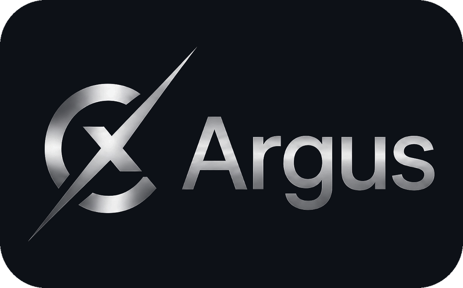
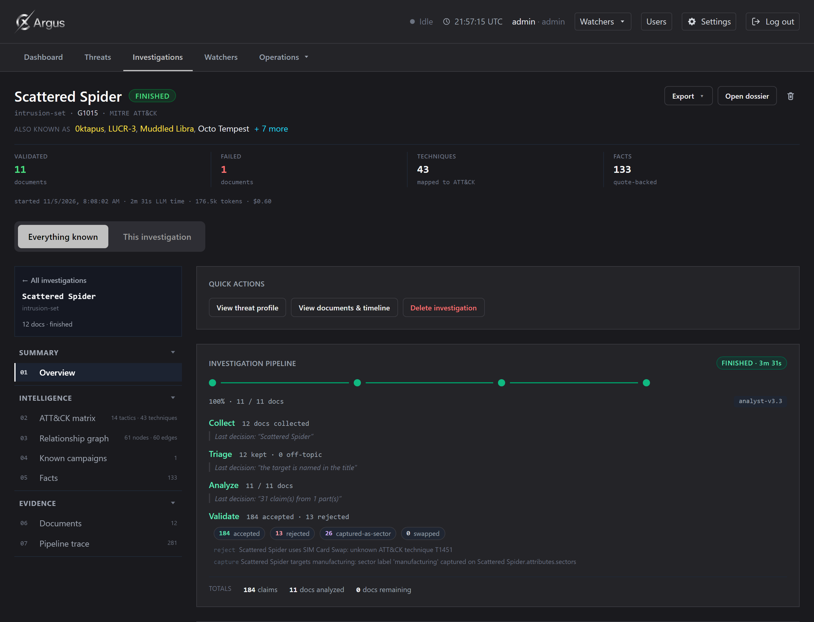
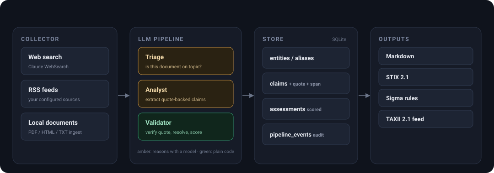
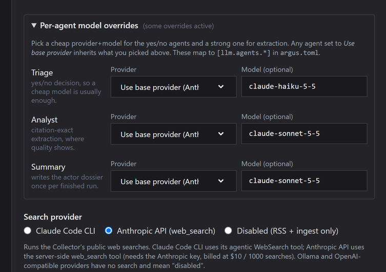

<p align="center">
  
</p>

**AI-powered adversary intelligence for purple teams.**

Argus investigates a threat across the web, your RSS feeds and documents you supply, extracts
quote-backed claims with an LLM, consolidates them into confidence-scored assessments mapped to
MITRE ATT&CK, and lets a human review every step. It runs entirely on your own machine.

- **Every claim carries a verbatim quote.** A separate check, written in plain code with no model
  involved, drops any claim whose quote is not in the source document. A model cannot invent its way
  past a step that asks for the receipt.
- **Every profile opens with the verdict.** Who the actor is, what it does, who it targets and how
  strong the evidence is, written from the consolidated assessments and refreshed on every run.
- **Corroboration counts organisations, not bylines.** One publisher row per organisation, resolved
  by domain, so seven CISA advisories are one source agreeing with itself and not seven confirmations.
- **Everything stays on your machine.** No telemetry and no third-party enrichment unless you opt in;
  no outbound call per fact.
- **Mapped to MITRE ATT&CK**, with exports to Markdown, STIX 2.1 and Sigma rules, every one
  TLP-aware and honest about the documents it could not read.
- **Every pipeline decision is traced**: what each agent decided, the token cost and the timings.

<p align="center">
  
</p>


## Architecture

<p align="center">
  <a href="docs/images/architecture.svg"></a>
</p>

The pipeline runs **once per document**, writing atomic claims plus the verbatim quote behind each
one and a per-stage audit row. The Validator verifies every quote against the text, resolves entities
against the local store and the ATT&CK catalogue, and consolidates claims across sources into the
assessments the UI renders. Only Triage, Analyst and the summary writer ever touch a model; the
Validator is plain code.

## Install

Argus ships its web UI **pre-built**, so installing needs only **Python 3.12+** (no Node, no build
step). It runs on Windows and Linux and is not on PyPI yet, so install it from the repository or a
release wheel.

```bash
# from a clone of the repository
git clone https://github.com/Cyllex-Framework/Cyllex-Argus.git
cd Cyllex-Argus
python3 -m venv .venv
. .venv/bin/activate              # Windows PowerShell: .venv\Scripts\Activate.ps1
pip install .

# ...or straight from GitHub, without cloning
pip install "git+https://github.com/Cyllex-Framework/Cyllex-Argus.git"
```

Either way puts the `argus` command on your PATH. Developers who work on Argus itself can use
[`uv`](https://docs.astral.sh/uv/) instead (`uv sync`); see the
[Development](docs/Development.md) page.

## Quickstart

```bash
argus init                                   # creates ~/.cyllex-argus/
argus attack update                          # downloads the MITRE ATT&CK Enterprise bundle
export ANTHROPIC_API_KEY='sk-ant-...'        # or the Claude Code CLI / Ollama; see Choosing a model below
argus investigate "Scattered Spider" --max-docs 10
argus serve                                  # web UI at the printed URL
```

On first launch `argus serve` downloads the ATT&CK catalog itself (about a minute) if you skipped
`argus attack update`; the first investigation waits for it to finish, so you never run one before
ATT&CK is loaded.

The UI opens on `http://127.0.0.1:8765` and logs in with **`admin` / `Argus123`** out of the box.
**Change it before exposing Argus on a network** (`argus set-admin-password '...'`, or the
`ARGUS_ADMIN_PASSWORD` environment variable, which never touches disk). Pass `argus serve --host
0.0.0.0` to accept clients from your LAN.

## Choosing a model

Argus's content pipeline (Triage, Analyst, Validator, summaries) runs on one of four providers.
Pick in **Settings → LLM provider** or edit `[llm]` in `~/.cyllex-argus/argus.toml`:

| Provider | Requires | Model (default) | Web search |
|---|---|---|---|
| `claude-code-cli` | Claude Pro/Max + the `claude` CLI logged in | subscription-controlled | Yes (built-in) |
| `anthropic-api` | `ANTHROPIC_API_KEY` (bring-your-own-key) | `claude-sonnet-5-5` | No, pair with `claude-code-cli` as the Search provider |
| `openai-api` | `OPENAI_API_KEY` | `gpt-4o` | No |
| `ollama` | Ollama running + a model pulled | `qwen2.5:32b-instruct` | No |

> **What has been tested.** Development and day-to-day testing ran mostly on **Claude**
> (`claude-code-cli` and `anthropic-api`) and local **Ollama**. The prompts are tuned against
> Claude; the OpenAI path works and its output is schema-enforced, but it has had less mileage and
> may extract fewer claims until the prompts are re-tuned.

### API-key providers (bring-your-own-key)

```bash
# Preferred: env wins over anything stored in argus.toml, and never touches disk
export ANTHROPIC_API_KEY='sk-ant-...'
# or:
export OPENAI_API_KEY='sk-...'
argus serve
```

Alternatively, paste the key in **Settings → LLM provider → API key**. The UI stores it under
`[llm.anthropic] api_key` / `[llm.openai] api_key` and shows it masked (`••••••••`) on reload so it
is never re-rendered in plaintext. The env var always wins, so rotation by `export` works without a
file edit.

### Model override and base URL

The provider page lets you override the default `model` (e.g. `gpt-4o-mini` for cheaper Triage,
`claude-opus-5-5` for deep Analyst runs) and the `base_url` (useful for OpenAI-compatible proxies
like OpenRouter, LocalAI, LiteLLM; the OpenAI adapter speaks the Chat Completions / Structured
Outputs contract and works against any server that implements it). A `model` set here overrides each
provider's default for **every** agent, so the page shows a banner with a one-click **Clear** when
one is active.

### Test connection

Each API-key provider has a **Test connection** button that calls `GET /v1/models` with the
configured credentials and reports what the server lists: it validates the key, the base URL and (if
a model id is entered) whether that model shows up on the account.

> **Anthropic:** an org- or user-scoped key (`sk-ant-usr-...`) returns **HTTP 400** on `/v1/models`
> unless it is **workspace-scoped**. If Test connection 400s with a key you know is valid, re-issue
> it as a workspace key, that (not a wrong key) is the usual cause.

### Per-agent model overrides

<p align="center">
  
</p>

The pipeline runs **three** LLM-backed agents: pick a cheap model for the yes/no agent and the good
one for extraction, from the same provider or from different ones (**Settings → LLM provider →
Per-agent model overrides**):

| Agent | What it does | Volume | Suggested |
|---|---|---|---|
| `triage` | *Is this document about the threat?* (yes/no) | 1 call per document | `gpt-4o-mini`, `claude-haiku-4-5`, cheap models answer a binary well |
| `analyst` | Extract claims with verbatim citations | 1-12 calls per document (chunks) | the strong one: `claude-sonnet-5-5`, `gpt-4o`, `claude-opus-5-5` |
| `summary` | Executive summary of a profile | 1 call per export | medium |

Any slot left as **Use base provider** inherits the main `[llm]` block, so the override costs
nothing when you don't want it. A typical cost-saving split:

```toml
# ~/.cyllex-argus/argus.toml
[llm]
provider = "anthropic-api"      # base: Analyst runs here on claude-sonnet-5-5

[llm.agents.triage]
provider = "openai-api"         # cheap/fast; env OPENAI_API_KEY must also be set
model = "gpt-4o-mini"
```

Validator is pure code (quote-verification + rule-based scoring, no LLM), so it never appears here.
Web search travels through `claude-code-cli` as the Search provider, so you can mix and match: a
local Ollama content model with Claude only for discovery, for example.

- **Web search** is only wired to `claude-code-cli`. Pick it as the **Search provider** even when
  your **Content provider** is `anthropic-api` / `openai-api` / `ollama`, or set Search to
  **Disabled** and rely on RSS + local ingest only.
- Prompts are tuned against Claude. GPT-family models may extract fewer claims per document until the
  prompts are re-tuned; the extraction schema is enforced server-side (Structured Outputs strict mode
  for OpenAI, tool-use for Anthropic) so the output is always schema-valid.

## Documentation

The complete reference lives in **[`docs/`](docs/README.md)**:

| Page | Covers |
|---|---|
| [Installation](docs/Installation.md) | install paths, prerequisites, first login, LAN mode |
| [How a Run Works](docs/How-a-Run-Works.md) | the pipeline in detail, the audit trace, incremental re-runs, the fetch rescue chain |
| [CTI Sources](docs/CTI-Sources.md) | TAXII and MISP subscriptions, RSS, opt-in IOC enrichment, webhooks |
| [Detections](docs/Detections.md) | Sigma rules and SigmaHQ references |
| [Web Interface](docs/Web-Interface.md) | the dashboard, threat profiles and watchers, with screenshots |
| [Source Reliability](docs/Source-Reliability.md) | Admiralty grades, ICD 203 confidence, publisher merging |
| [TAXII 2.1 Server](docs/TAXII-Server.md) | the read-write TAXII node other tools subscribe to |
| [CLI Reference](docs/CLI-Reference.md) | every `argus` command |
| [Configuration](docs/Configuration.md) | the `argus.toml` reference and exports |
| [Users, Roles & Security](docs/Users-Roles-and-Security.md) | accounts, roles, sessions, and exactly what leaves the machine |
| [Development](docs/Development.md) | the dev harness, test suite and project layout |

## License

Free for non-commercial use under the **PolyForm Noncommercial** license. See [LICENSE](LICENSE).
