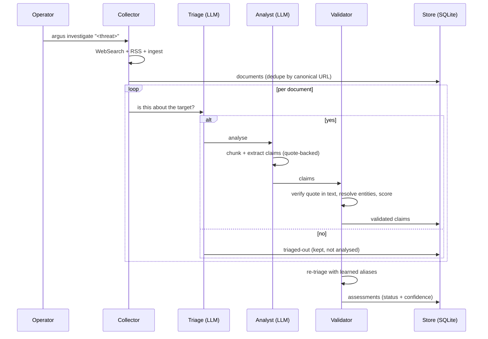

# How a Run Works

_[Back to the docs index](README.md)_

## When a publisher refuses

Argus reads human-written reports as a primary source, which most CTI platforms deliberately do
not: they consume structured feeds and leave the fetching of a vendor blog post to a person. So
the fetch layer is a first-class subsystem here, and it has a documented order of attempts.

**The rescue chain**, on an HTTP 4xx — "we read you and said no":

1. **Retry once with a browser User-Agent.** Catches gates that match the UA string alone.
2. **Retry through curl_cffi with Chrome's full TLS handshake.** Akamai and Cloudflare fingerprint
   the Python TLS stack (JA3/JA4) and refuse httpx *even when it sends the same User-Agent curl
   is served with* — measured against cisa.gov. Redirects are followed here, one hop at a time
   with the SSRF guard on each, because the gate answers httpx with 403 before it will serve the
   301 and this is the only path that ever sees it.
3. **Fall back to the Wayback Machine** for anything the publisher still refuses or says is gone.

429 and 5xx never reach the chain: those are capacity, not identity, and the retry loop with
exponential backoff handles them.

**What it will not do.** Publishers that document an automated-access policy are complied with,
not worked around. The SEC's is explicit — declare a User-Agent with contact details, stay under
the rate limit, and you are served, and unidentified tools are blocked — so for `sec.gov` Argus
keeps its own identifying UA, does not pivot to a generic Chrome string (the thing that policy
blocks) and does not TLS-impersonate a browser. A refusal from them is a refusal.

**Supplying the document yourself.** Some refusals are permanent and correct: an access policy, a
page behind a login, a host that times out. The Documents page offers **Upload the file** on any
failed document — open the page in your own browser, save it, hand Argus the file. The *same*
document row is repaired, so its URL, publisher and links to the investigations that collected it
all survive, and the dossier's evidence base closes the gap instead of gaining an unlinked record
beside it. A supplied document goes through the same triage, quote verification and scoring as
anything Argus fetched: handing over a file does not make it more trustworthy.

## Pipeline in detail

### What each agent writes to the trace

Every stage records a row in `pipeline_events` with timestamp, document id, decision, reason,
duration and (for LLM stages) input/output tokens and USD cost. The result is a per-document,
per-investigation audit log you can read on the dashboard or the global Logs tab.

| Stage | Decisions |
|---|---|
| `collector` | `collected`, `failed` (with the reason: 404, size cap, etc.) |
| `triage` | `triaged-in`, `triaged-out`, `failed` |
| `analyst` | `analyzed` (with claim count), `failed` |
| `validator` | `validated`, `rejected` (per claim; the reason names the ATT&CK gap or the missing quote) |
| `pipeline` | `failed` (unexpected exception that aborted one document) |

**LLM trace retention** (`[logging] retain_raw_llm`): `off` (default), `errors` (store raw prompts
only on rejections/failures), or `full` (every exchange). Switch at runtime from the Settings
page; `argus trace purge --raw` reclaims disk without losing event rows.

### Re-investigating a known threat (incremental runs)

Running `argus investigate "<threat>"` a second time does **not** start from scratch, and does not
duplicate what you already have. The store is shared and additive, so a re-run only pays for what
is genuinely new:

- **Documents already read are reused, not re-fetched or re-read.** Sources are deduplicated by
  canonical URL and by content hash (`documents.canonical_url` / `content_hash` are `UNIQUE`). A
  document a previous run already downloaded is linked to the new investigation with **no network
  call**, and — if it was validated under the current Analyst prompt — with **no LLM call** either.
  You pay tokens only for sources you have not read before. The one exception is a prompt-version
  bump: when Argus ships a better Analyst prompt, previously-read documents are re-analysed once to
  refresh their extraction, never duplicating the old claims.
- **The collection log says which is which.** Each candidate is logged as `Reusing N/M: <url>` or
  `Downloading N/M: <url>`, and the run closes with a one-line split, e.g.
  `Documents: 2 fetched, 8 reused, 0 failed`. On the dashboard, reused documents produce no new
  triage/analyst events — only the newly-read ones do.
- **Facts accumulate; corroboration rises, it does not duplicate.** New claims are appended as
  additional quote-backed evidence. The consolidated view (`assessments`, one row per
  subject–predicate–object) is **upserted**, so a second source saying the same thing raises
  confidence and Admiralty rather than adding a duplicate finding. Multiple claims from the *same*
  publisher count as one voice; only distinct publishers corroborate.
- **The threat is matched to the existing entity by alias** (case-insensitive). If a report uses a
  name Argus has never seen as an alias of that actor (e.g. a brand-new cross-vendor nickname), the
  run can create a separate "ghost" entity; reconcile it with `argus entity-merge`.
- **The executive summary is refreshed at the end of every finished run that accepted facts** (it is
  overwritten, last-write-wins). Facts that arrive by other means (e.g. a STIX import) leave the
  cached summary in place and the UI marks it stale until you regenerate it.

Each re-run is still its own investigation row (linked to the same entity), so the pipeline trace,
token cost and evidence base of every run stay independently auditable.

---
_[Back to the docs index](README.md)_
