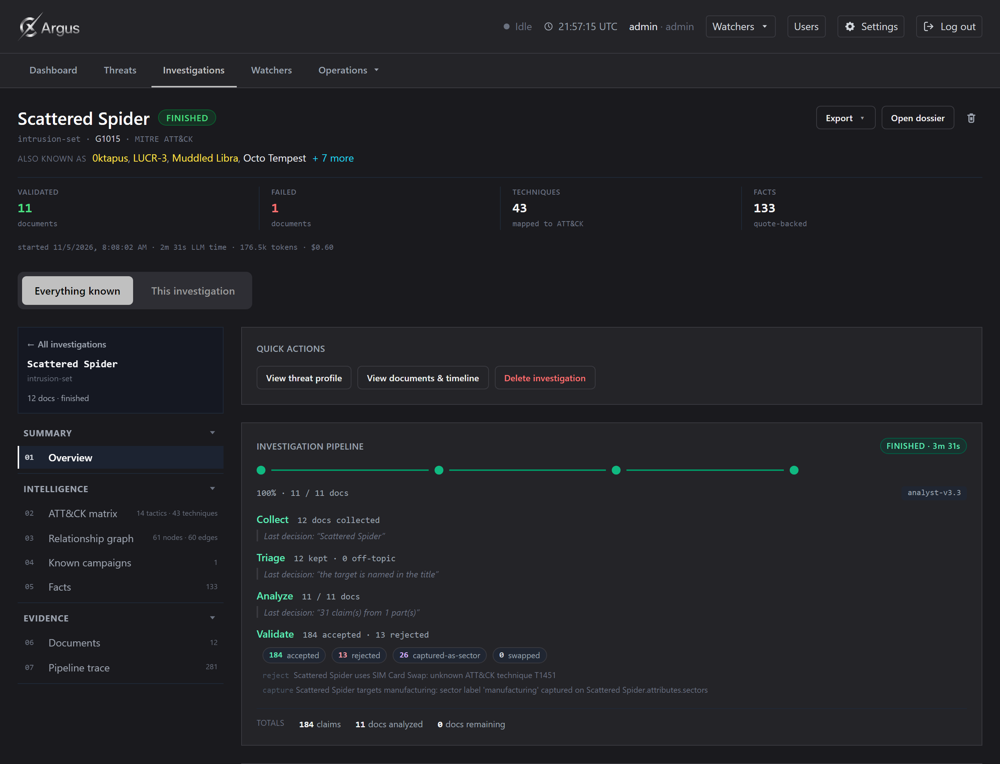
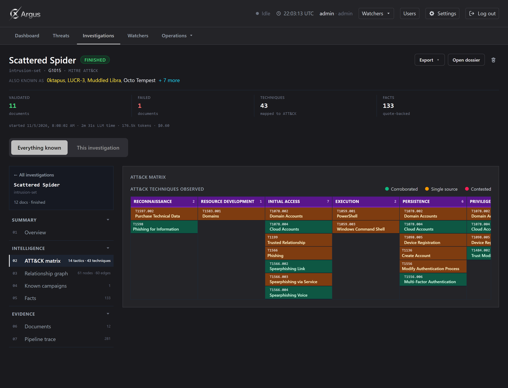
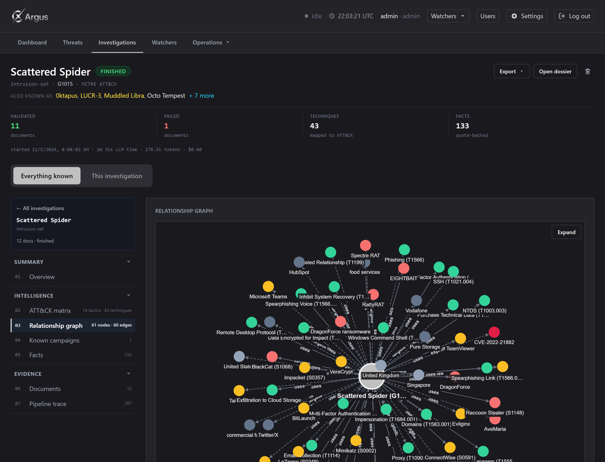
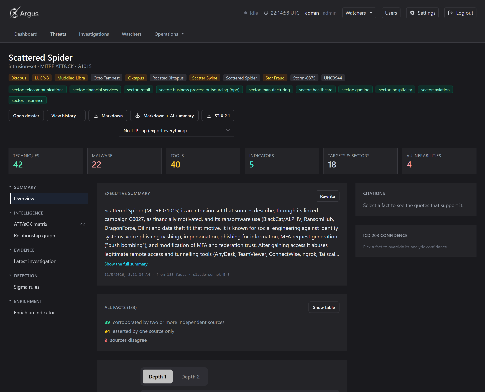

# Web Interface

_[Back to the docs index](README.md)_

## Web interface

```bash
uv run argus serve                                              # http://127.0.0.1:8765, loopback only
uv run argus serve --host 0.0.0.0 --port 8766 --no-browser      # accept LAN clients
```

The server listens on `127.0.0.1` by default. With `--host 0.0.0.0` it also accepts requests from
other machines on your LAN and prints a URL bound to the detected LAN IP. The token still travels
in plain HTTP in LAN mode — use only on a trusted network.

### Getting around

Five tabs, because a first glance should be a handful of choices and not a directory:
**Dashboard**, **Threats**, **Investigations**, **Watchers**. The plumbing pages —
Documents, Query, Logs, Sources — sit behind an **Operations** menu that marks itself active and
names the page it is on, so a collapsed menu never loses you. **Settings** is a button in the
top-right of the header rather than an entry in that menu: it is the page reached for most often.
Next to it, a **Watchers** menu glances at every standing monitor — its next run or paused state,
any unseen changes, and the ones running right now — and jumps to a watcher's investigation.

The dashboard leads with what needs a decision. A missing prerequisite is stated with its fix
(the **Update ATT&CK** button is there, not in a manual), and **Data health** collapses to one
line of counts that opens into the detail and links to where each one is fixed.

### Session

The web UI is gated by a login screen — there is no `#token=` URL bypass. On the first visit you
log in with an admin / operator / reader account; from then on:

1. `POST /api/auth/login` issues a per-user session token, which the SPA stores in `localStorage`
   under the origin.
2. The token travels in an `X-Argus-Token` header on every API request (never as a cookie).
3. Non-GET requests also send `X-Argus-CSRF: 1`. Pages from another origin cannot add custom
   headers without a CORS preflight, which Argus refuses.
4. Sessions are server-side: logging out, or disabling / deleting the user or changing their
   password, revokes the session immediately. A revoked or expired token returns 401 and the SPA
   drops back to the login screen.

Sessions expire after `--session-ttl` seconds (default 7 days, `604800`). Pass `--session-ttl 0`
to disable expiry — reasonable for a long-lived daemon that is already behind the login, but a
leaked token then stays valid until logout.

Additionally:

- `Host` header is checked against an allowlist (`127.0.0.1:<port>`, `localhost:<port>`, and the
  LAN IP in LAN mode). DNS-rebinding attacks are refused with 403.
- Only files that exist in the built static directory are served. Paths like `/\\host\share` can
  never reach the filesystem.
- Long operations (investigate, ingest, attack_update, recompute) run one at a
  time through a `JobManager`, with live progress streamed over SSE.

### Developing the interface

```bash
cd web
npm install
npm test                  # Vitest unit tests
npm run dev               # http://localhost:5173, proxies /api to argus serve on port 8765
npm run build             # rebuild src/cyllex_argus/web/static — commit the result
```

For `npm run dev`, start `argus serve --no-browser` first, then open `http://localhost:5173`
and log in. Vite proxies `/api` to the backend on port 8765.


## Investigation dashboard







Open any investigation (`/investigations/<id>/dashboard`) and you get:

- A **header** with the resolved threat (name, type, aliases from ATT&CK or documents), state
  pill, counts, cost of the LLM calls for this run, export buttons (Markdown, Markdown + AI
  executive summary, STIX 2.1).
- An **ATT&CK matrix** of observed techniques, 14 tactics as columns, techniques coloured by
  status (`corroborated` / `single-source` / `contested`). Clicking a technique opens the side
  panel with its citations verbatim.
- A **relationship graph** (Cytoscape) with kill-chain and force layouts, filters by node type,
  search, Focus APT, and a per-node freshness ring on indicators.
- A **pipeline trace** card grouped by document, with per-stage events, costs and (if enabled) a
  **Show raw** button that reveals the LLM prompt / response.
- A **scope toggle**: "Everything known" vs "This investigation" (facts whose citations come only
  from this run).


## Threat profile



`/threats/<id>` uses a **sidebar + section** layout: sections grouped by purpose (Summary /
Intelligence / Evidence / Detection / Enrichment), the active section rendered on the
right, choice persisted as `?section=` so a reload or deeplink restores the view. Narrow
viewports (≤900 px) fall back to the vertical stack.

- **Overview** — stat tiles, exports, flat facts table (collapsed by default).
- **Matrix** — ATT&CK matrix + Indicators / Malware / Tools / Targets / Vulnerabilities /
  Attribution breakdowns. Citations panel docks on the right.
- **Latest investigation** — live tree of the most recent run against this threat.
- **Sigma rules** — Sigma YAML detections, downloadable per rule.
- **Enrich an indicator** — opt-in third-party pivots.
- **Identity attributes** — sector / country, only on identity entities.


## Watchers

A **watcher** turns a target into a standing monitor: it re-investigates on a cadence, reuses the
normal pipeline (Collector → Triage → Analyst → Validator), and after each completed run reports
**what changed** since last time — mostly new information, plus the occasional status change on
something already known. Watchers add no new reasoning: the scheduler fires the existing
`investigate` job, a deterministic diff compares the target's current assessed facts against the
watcher's stored snapshot, and the resulting change events feed the page and the configured
webhooks. Watchers is the single home for recurring monitoring — it replaced the old "Schedules"
page (both were always the same `scheduled_investigations` rows), and `/schedules` redirects here.

- **Create** (Watchers tab → New watcher, operator+): a target and a cadence (daily / weekly /
  monthly or a custom cron), and optionally the run controls a one-off investigation has — **max
  docs** and **concurrency**. Alert channels and the reliability floor are set once in Settings.
- **Run**: each watcher has **Run now** (fire immediately, off-cadence — it reconciles the feed and
  sends alerts exactly as a scheduled tick would), **pause / resume**, and **delete** (which removes
  only the watcher; the intelligence its runs produced stays in the knowledge base).
- **Review**: open a watcher's row to expand its own change feed — **new info**, **new source**,
  **verified**, **weakened**, **contested** — grouped by day. Every signed-in user sees every
  watcher and the full feed with a per-user "unseen" count; pausing or deleting is restricted to
  the owner (or an admin).
- **At a glance**: the header's **Watchers** menu shows each one's next run or paused state, any
  unseen changes, and the ones running right now, and jumps straight to a watcher's investigation.

Alerts go to the webhooks under **Settings → Webhooks** (once per change, de-duplicated; a failed
send retries on the next run), for changes backed by a source at or above `watchers.min_reliability`
(Admiralty `C` by default). The scheduler lives inside `argus serve`, so watchers fire only while
the server is up; the CLI equivalent is the `argus schedule` group. See
[docs/watchers.md](watchers.md) for the design detail.


---
_[Back to the docs index](README.md)_
